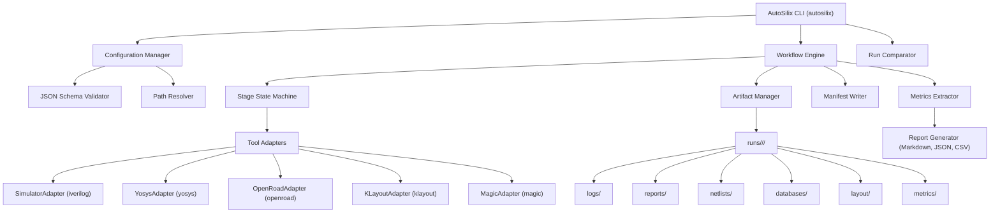
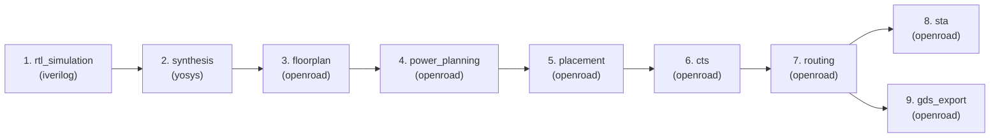

# AutoSilix

**Reproducible RTL-to-GDSII Automation and PPA Analysis Framework**

> *"From RTL to layout, reproducibly."*

[](https://www.python.org/)
[](LICENSE)
[]()
[](https://github.com/astral-sh/ruff)

---

## 1. Project Description

**AutoSilix** is an open-source, configuration-driven Electronic Design Automation (EDA) framework that automates digital IC design from Register-Transfer Level (RTL) validation and logic synthesis through physical layout generation and Power-Performance-Area (PPA) metric extraction.

It orchestrates established open-source EDA tools (Icarus Verilog, Yosys, OpenROAD, KLayout, Magic) within a unified, reproducible software architecture.

---

## 2. Problem Statement

Open-source silicon development has made significant strides with tools like Yosys and OpenROAD, but designing digital ASICs remains fraught with operational hurdles:

- **Fragmented Toolchains**: Disjointed scripts with inconsistent inputs, non-standard outputs, and unversioned parameters.
- **Reproducibility Gaps**: Subtle environment differences, unpinned tool versions, and undocumented flags make reproducing layout runs notoriously difficult.
- **Provenance Deficits**: Metrics like area, worst slack, or wire length are often reported in isolated logs without traceable links back to their source reports or timing corners.
- **Unverified Signoff Claims**: Prototype layout exports (GDSII) are frequently conflated with fabrication-ready signoff.

AutoSilix solves these problems by providing:
1. Strict schema-validated configuration.
2. Isolated, collision-free run directories.
3. Machine-readable manifest tracking Git revisions, environment data, and per-stage logs.
4. Robust PPA extraction preserving source report references and measurement units.
5. Incomparable-run protection to prevent misleading conclusions.

---

## 3. Key Features

- **Configuration-Driven**: Declarative YAML configuration strictly validated by JSON Schema (Draft 2020-12).
- **Stage State Machine**: Explicit stage progression (`PENDING`, `RUNNING`, `PASS`, `FAIL`, `SKIPPED`, `UNSUPPORTED`) with prerequisite enforcement and fail-fast options.
- **Decoupled Tool Adapters**: Isolated adapters for RTL simulation (`iverilog`/`verilator`), logic synthesis (`yosys`), physical design (`openroad`), layout inspection (`klayout`), and physical verification (`magic`).
- **Complete Run Isolation**: Every run generates a unique directory (`runs/<design>/<run-id>/`) containing configuration snapshots, logs, reports, databases, netlists, and layout stream files.
- **PPA Comparison Engine**: Direct side-by-side comparison of compatible runs with metric deltas, percentage changes, and design compatibility checks.
- **Multi-Design Verification**: Out-of-the-box support for multiple synthesizable designs:
  - `sequence_detector`: Synthesizable `1011` overlapping detector with self-checking testbench.
  - `alu_accumulator`: 8-bit Arithmetic Logic Unit with internal accumulator register.
- **Built-in Mock Engine**: Allows continuous testing, verification, and framework development on systems without full EDA installations.

---

## 4. Architecture Diagram



---

## 5. Workflow Diagram



---

## 6. Supported Functionality

| Capability | Status | Notes |
|---|---|---|
| Configuration Schema Validation | **Complete** | Draft 2020-12 schema validation (`config.schema.json`) |
| CLI Interface | **Complete** | Commands: `validate`, `run`, `status`, `report`, `compare`, `tools` |
| Stage State Machine | **Complete** | States: `PENDING`, `RUNNING`, `PASS`, `FAIL`, `SKIPPED`, `UNSUPPORTED` |
| Isolated Run Artifacts | **Complete** | Collision-proof directories with effective configuration snapshots |
| Atomic Provenance Manifest | **Complete** | Full host, tool, and stage metadata saved to `manifest.json` |
| Yosys Synthesis Integration | **Complete** | Script generation, gate netlist export, area stat capture |
| OpenROAD Physical Flow | **Complete** | Floorplanning, PDN, placement, CTS, routing, STA, GDS stream-out |
| Metrics Extraction | **Complete** | Area, cell counts, slack, delay, wire length, DRC violations |
| Run Comparison Engine | **Complete** | Incompatibility checks, deltas, percentage changes |
| Multi-Design Support | **Complete** | `sequence_detector` and `alu_accumulator` verified |
| Unit & Integration Test Suite | **Complete** | 50 passing automated tests covering failure injection and e2e |
| GitHub Actions CI | **Complete** | Multi-version Python testing and RTL verification workflows |

---

## 7. Toolchain Prerequisites

### Core Software
- **Python**: `>=3.10`
- **Git**: `>=2.20`

### External EDA Tools (Optional for Mock Testing, Required for Real Fabrication Flows)
- **Icarus Verilog**: `>=11.0`
- **Yosys**: `>=0.25`
- **OpenROAD**: `>=2.0`
- **KLayout**: `>=0.28`
- **Magic VLSI**: `>=8.3`
- **Target PDK**: SkyWater SKY130 (`sky130_fd_sc_hd`)

---

## 8. Installation Instructions

```bash
# 1. Clone repository
git clone https://github.com/your-org/autosilix.git
cd autosilix

# 2. Set up virtual environment
python -m venv .venv
source .venv/bin/activate  # On Windows: .venv\Scripts\activate

# 3. Install in editable mode with development dependencies
pip install -e ".[dev]"
```

---

## 9. Quick-Start Commands

### Check Toolchain Availability
```bash
autosilix tools
```

### Validate Design Configuration
```bash
autosilix validate --config configs/designs/sequence_detector.yaml
```

### Execute Flow (Mock Testing Mode)
```bash
autosilix run --config configs/designs/sequence_detector.yaml --mock
```

### Query Run Status
```bash
autosilix status --run-id <RUN_ID>
```

### Generate Run Summary Report
```bash
autosilix report --run-id <RUN_ID> --format markdown
```

### Compare Two Implementation Runs
```bash
autosilix compare --runs <RUN_ID_A> <RUN_ID_B>
```

---

## 10. Example Configuration

```yaml
schema_version: "1.0.0"

design:
  name: "sequence_detector"
  top_module: "sequence_detector"
  rtl_files:
    - "designs/sequence_detector/rtl/sequence_detector.v"
  tb_files:
    - "designs/sequence_detector/tb/tb_sequence_detector.v"
  constraints_file: "designs/sequence_detector/constraints/sky130_constraints.sdc"

pdk:
  name: "sky130"
  variant: "sky130_fd_sc_hd"
  std_cell_library: "sky130_fd_sc_hd"
  pdk_root: "/usr/local/share/pdk"

constraints:
  clock_period: 10.0
  clock_port: "clk"
  clock_uncertainty: 0.25
  input_delay: 2.0
  output_delay: 2.0

physical:
  core_utilization: 0.35
  core_aspect_ratio: 1.0
  core_margin: 10.0

synthesis:
  strategy: "AREA"
  flatten: true

flow:
  stages:
    - rtl_simulation
    - synthesis
    - floorplan
    - power_planning
    - placement
    - cts
    - routing
    - sta
    - gds_export
  fail_fast: true
```

---

## 11. Example Test Execution

```bash
# Run complete test suite
python -m pytest tests/

# Run code style and linting checks
python -m ruff check src tests
```

---

## 12. Example Run Report

Generated from `autosilix report --run-id run_20261025_110907_04e9a4`:

```markdown
# AutoSilix Implementation Report

**Design**: `sequence_detector` | **Run ID**: `run_20261025_110907_04e9a4` | **Status**: 🟢 **PASS**

## 1. Run Provenance & Environment
- **Total Duration**: `0.59s`
- **Git Revision**: `2.52.0`
- **Operating System**: `Windows-11-10.0.26300-SP0`
- **Python Version**: `3.14.7`

## 2. Stage Execution Summary
| Stage | State | Duration (s) | Exit Code | Log File |
|---|---|---|---|---|
| `rtl_simulation` | `PASS` | 0.01 | `0` | `rtl_simulation.log` |
| `synthesis` | `PASS` | 0.01 | `0` | `synthesis.log` |
| `floorplan` | `PASS` | 0.02 | `0` | `floorplan.log` |
| `power_planning` | `PASS` | 0.02 | `0` | `power_planning.log` |
| `placement` | `PASS` | 0.02 | `0` | `placement.log` |
| `cts` | `PASS` | 0.02 | `0` | `cts.log` |
| `routing` | `PASS` | 0.01 | `0` | `routing.log` |
| `sta` | `PASS` | 0.01 | `0` | `sta.log` |
| `gds_export` | `PASS` | 0.02 | `0` | `gds_export.log` |

## 3. Extracted PPA Metrics
| Metric Name | Value | Unit | Stage | Source File |
|---|---|---|---|---|
| `cell_area` | **124.5** | um^2 | `synthesis` | `synthesis.rpt` |
| `cell_count` | **18** | - | `synthesis` | `synthesis.rpt` |
| `clock_target` | **10.0** | ns | `sta` | `sta.rpt` |
| `core_utilization` | **35.0** | % | `floorplan` | `floorplan.rpt` |
| `critical_path_delay` | **4.18** | ns | `sta` | `sta.rpt` |
| `setup_slack` | **5.57** | ns | `sta` | `sta.rpt` |
| `wire_length` | **685.4** | um | `routing` | `routing.rpt` |
| `unrouted_nets` | **0** | - | `routing` | `routing.rpt` |
```

---

## 13. PPA Methodology

AutoSilix compares digital implementations using controlled single-variable experiments:
- **Baseline vs Variant**: Compares runs under identical PDKs and target stages.
- **Delta Analysis**: Calculates $\Delta = V_{\text{variant}} - V_{\text{baseline}}$ and percentage variation.
- **Incompatible Run Protection**: Flags mismatched designs or PDKs instead of generating misleading metrics.

---

## 14. Testing Instructions

The test suite covers:
- **Unit Tests**: Schema validation, path resolution, timeout handling, report parsers.
- **Failure Injection**: Missing files, nonzero tool exit codes, tool crashes, duplicate run collisions.
- **Integration**: Full mock pipeline execution for multiple RTL designs.

```bash
python -m pytest -v tests/
```

---

## 15. Known Limitations

> [!CAUTION]
> **A generated GDSII stream does NOT constitute tape-out or fabrication readiness.**
> Fabrication requires signoff-grade DRC/LVS decks, exhaustive multi-corner STA, electromigration, and foundry physical verification reviews.

- **Power Estimation**: Power numbers are only meaningful when standard-cell Liberty power tables and valid dynamic switching activity files (VCD/SAIF) are provided.
- **Platform Portability**: Tested platform reference flow targets SkyWater SKY130. GF180MCU support is scheduled for upcoming milestones.

---

## 16. Development Roadmap

- [x] Python framework core, schema validation, and CLI.
- [x] Synthesizable sequence detector (`1011` overlapping) with self-checking testbench.
- [x] Yosys synthesis and OpenROAD physical design flow adapters.
- [x] Run isolation, atomic manifest generation, and provenance tracking.
- [x] PPA metrics extraction, report generator, and run comparison engine.
- [x] 8-bit ALU accumulator second design with multi-design verification.
- [x] Automated test suite (50 passing tests) and GitHub Actions CI.
- [ ] GlobalFoundries GF180MCU PDK flow qualification.
- [ ] FlexRISC16 microprocessor core reference flow.
- [ ] Multi-corner multi-mode (MCMM) timing analysis.

---

## 17. Contribution Guidance

1. Fork the repository and create your feature branch: `git checkout -b feature/my-feature`.
2. Ensure linting passes: `ruff check src tests`.
3. Ensure all tests pass: `pytest tests/`.
4. Submit a Pull Request with detailed descriptions and test evidence.

---

## 18. License

Licensed under the **Apache License, Version 2.0**. See the [LICENSE](LICENSE) file for complete terms.
