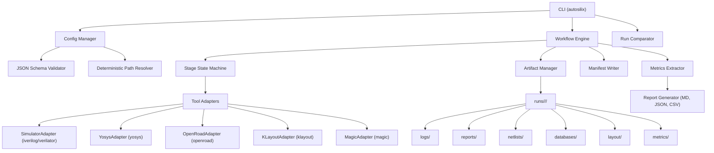

# AutoSilix Architecture Specification

## 1. System Overview

AutoSilix is a configuration-driven automation and analysis framework that orchestrates digital ASIC implementation pipelines from RTL to GDSII layout stream.

## 2. Core Subsystems

### 2.1 Configuration Layer (`autosilix.config`)
- Loads YAML configuration files.
- Strictly validates structure against Draft 2020-12 JSON Schema (`schemas/config.schema.json`).
- Resolves all file paths relative to the project root to decouple execution from the current working directory.
- Computes SHA256 content hashes for configuration provenance.

### 2.2 Toolchain Discovery (`autosilix.toolchain`)
- Inspects PATH for EDA tool binaries (`iverilog`, `vvp`, `verilator`, `yosys`, `openroad`, `klayout`, `magic`).
- Safely extracts tool version information using version flags and regular expressions.
- Inspects Git repository state (HEAD commit and dirty working tree status).

### 2.3 Stage State Machine (`autosilix.stages`)
- Formally models stage progression:
  - `PENDING`: Initial registered state before invocation.
  - `RUNNING`: Active execution in subprocess.
  - `PASS`: Tool exited with code 0 and generated expected output files.
  - `FAIL`: Tool exited with nonzero returncode, timed out, or missed required outputs.
  - `SKIPPED`: Downstream stage skipped due to prior failure or missing dependencies.
  - `UNSUPPORTED`: Stage not supported by current platform or missing signoff deck.

### 2.4 Subprocess Execution & Logging (`autosilix.runner`)
- Never executes commands via raw shell string concatenation; uses verified argument vectors.
- Streams stdout and stderr to stage-specific log files (`logs/<stage>.log`).
- Enforces configurable per-stage execution timeouts with process-tree termination.

### 2.5 Run Isolation & Provenance (`autosilix.artifacts` & `autosilix.manifest`)
- Every execution creates a unique, collision-proof run folder:
  `runs/<design_name>/<run_id>/`
- Snapshots the effective configuration to `config/effective_config.yaml`.
- Atomic manifest persistence via temporary file rename ensures manifest integrity even under abrupt process termination.

### 2.6 Metrics & Comparison Engine (`autosilix.metrics` & `autosilix.compare`)
- Parses raw text reports using robust regex extractors.
- Associates every extracted numeric value with its source stage, source file, unit, and parser version.
- Enforces compatibility boundaries (e.g. comparing two different designs is prohibited).
