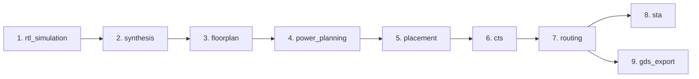

# AutoSilix Workflow Stages & Contracts

## Stage Pipeline

## Stage Contracts

| Stage | Prerequisites | Primary Tool | Key Artifact Generated |
|---|---|---|---|
| `rtl_simulation` | None | Icarus Verilog (`iverilog`) | `logs/rtl_simulation.log` |
| `synthesis` | `rtl_simulation` | Yosys | `netlists/synthesized.v`, `reports/synthesis.rpt` |
| `floorplan` | `synthesis` | OpenROAD | `databases/floorplan.def`, `reports/floorplan.rpt` |
| `power_planning` | `floorplan` | OpenROAD | `databases/pdn.def`, `reports/pdn.rpt` |
| `placement` | `power_planning` | OpenROAD | `databases/placed.def`, `reports/placement.rpt` |
| `cts` | `placement` | OpenROAD | `databases/cts.def`, `reports/cts.rpt` |
| `routing` | `cts` | OpenROAD | `databases/routed.def`, `reports/routing.rpt` |
| `sta` | `routing` | OpenROAD | `reports/sta.rpt` |
| `drc` | `routing` | KLayout / Magic | `reports/drc.rpt` |
| `lvs` | `routing` | Magic | `reports/lvs.rpt` |
| `gds_export` | `routing` | OpenROAD / KLayout | `layout/final.gds` |
