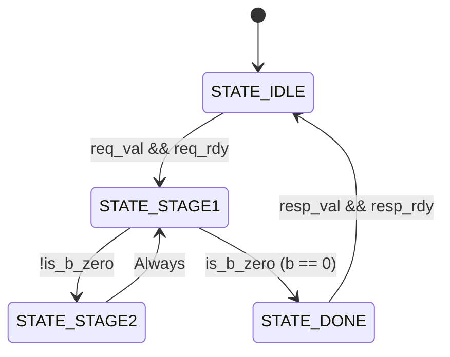

# AutoSilix Experiment 06 — 8-bit Split Pipelined GCD Architecture

> **Status: NOT timing-closed.** The 1.10 ns target has **not** been met. Only detailed-placement
> results exist (ideal clock, no CTS, no routing); there are no routed results. See section 6.

## 1. Executive Summary

- **Design**: Greatest Common Divisor (GCD) unit (`gcd`), subtractive algorithm
- **PDK**: SKY130HD (130 nm bulk CMOS)
- **Clock Target**: 1.10 ns (909.09 MHz), unchanged
- **Architecture**: Two-stage carry-pipelined arithmetic datapath with decoupled output path
- **Key Strategy**: Strategy B — 8-bit split arithmetic pipeline
- **Measured result (detailed placement)**: WNS -1.2638 ns, TNS -67.6511 ns, 84 setup violations, 0 hold violations, minimum period 2.36 ns (423.05 MHz). The original analytical estimate of ~650 MHz was **not** achieved.
- **Verification**: 26 directed cases plus randomized, backpressure, chained-request and reset testing across the layers in section 5. The revised Verilog testbench has **not yet been executed**; the Python model, an exhaustive arithmetic check and a post-synthesis netlist simulation pass.

---

## 2. Problem Statement & Timing Bottleneck

In Baseline and Experiments 01–05, the GCD datapath executes the complete 16-bit subtraction, magnitude comparison, and feedback multiplexing within a single clock cycle.

OpenROAD STA timing reports (`6_finish_original.rpt`) revealed two critical timing paths:

1. **Internal Datapath Loop Violation (WNS: -1.3954 ns, Arrival: 2.54 ns, Required: 1.15 ns)**:
   - Flip-flop launch clock-to-Q (`sky130_fd_sc_hd__edfxtp_1`): 0.42 ns
   - 16-bit parallel-prefix Kogge-Stone subtractor: 1.10 ns
   - Rebuffering and placement buffers: 0.24 ns
   - 3-input A-multiplexer: 0.21 ns
   - Flip-flop setup time: 0.26 ns
   - Fixed sequential overhead ($T_{clk-q} + T_{setup} = 0.68\text{ ns}$) leaves only 0.42 ns for logic and routing at a 1.10 ns clock target.
2. **Output Port Timing Violation (WNS: -1.26 ns, Arrival: 2.43 ns, Required: 1.17 ns)**:
   - Output `resp_msg` was wired to `sub$out`. In `STATE_DONE`, $B = 0$ so $A - B = A$.
   - Wiring through the subtractor added 1.10 ns of unnecessary delay to the output pads.

---

## 3. Pipelined Architecture Design (Strategy B)

```
                       ┌─────────────────────────────────────────────────────────────┐
                       │                          STAGE 1                            │
                       │                                                             │
  a_reg[15:0] ─────────┴─► [ a[7:0] ] ─────────┬─► diff_lo[7:0] ──► [pipe_diff_lo]  │
                       │                       │                                     │
  b_reg[15:0] ─────────┴─► [ b[7:0] ] ─────────┴─► borrow_mid  ──► [pipe_borrow_mid]│
                       │                                                             │
                       │   [ a[15:8] ] ───────────────────────────► [pipe_a_hi]     │
                       │   [ b[15:8] ] ───────────────────────────► [pipe_b_hi]     │
                       │   [ a[7:0]  ] ───────────────────────────► [pipe_a_lo]     │
                       │   [ b[7:0]  ] ───────────────────────────► [pipe_b_lo]     │
                       └─────────────────────────────────────────────────────────────┘
                                                      │
                                                      ▼
                       ┌─────────────────────────────────────────────────────────────┐
                       │                          STAGE 2                            │
                       │                                                             │
                       │  pipe_a_hi - pipe_b_hi - pipe_borrow_mid                    │
                       │  ├── diff_hi[7:0] ──► sub_diff = {diff_hi, pipe_diff_lo}    │
                       │  └── borrow_final ──► (A < B comparison)                    │
                       │                                                             │
                       │  Decision:                                                  │
                       │  ├── If borrow_final (A < B): SWAP A and B                  │
                       │  └── Else (A >= B):           A <= sub_diff                 │
                       └─────────────────────────────────────────────────────────────┘
                                                      │
                                                      ▼
                                       Updated a_reg & b_reg
```

### 3.1 Datapath Stage Breakdown

#### Stage 1: Low-Byte Subtraction & Pipeline Register Capture
- **Operations**:
  $$\text{diff\_lo}[7:0] = a\_reg[7:0] - b\_reg[7:0]$$
  $$\text{borrow\_mid} = (a\_reg[7:0] < b\_reg[7:0])$$
- **Logic Depth (analytical assumption, not measured)**: an 8-bit parallel-prefix carry tree ($\lceil \log_2(8) \rceil = 3$ prefix stages vs. 4 for 16-bit). The synthesis log shows Yosys evaluating several adder architectures (Han-Carlson and Kogge-Stone options); the architecture finally chosen is not recorded.
- **Combinational Delay**: ~0.49 ns was an *analytical estimate*. Stage-1 timing was not reported separately by the placement run.
- **Pipeline Registers**:
  - `pipe_diff_lo[7:0]`: Latches low-byte difference.
  - `pipe_borrow_mid`: Latches intermediate borrow bit.
  - `pipe_a_hi[7:0]`, `pipe_b_hi[7:0]`: Carries high bytes to Stage 2.
  - `pipe_a_lo[7:0]`, `pipe_b_lo[7:0]`: Carries low bytes for potential swap.

#### Stage 2: High-Byte Subtraction & Operand Writeback
- **Operations**:
  $$\text{diff\_hi}[7:0] = \text{pipe\_a\_hi} - \text{pipe\_b\_hi} - \text{pipe\_borrow\_mid}$$
  $$\text{borrow\_final} = (\{1'b0, \text{pipe\_a\_hi}\} < (\{1'b0, \text{pipe\_b\_hi}\} + \text{pipe\_borrow\_mid}))$$
- **Difference Assembly**: $\text{sub\_diff}[15:0] = \{\text{diff\_hi}[7:0], \text{pipe\_diff\_lo}[7:0]\}$.
- **Decision & Writeback**:
  - If `borrow_final` ($A < B$): $A \leftarrow B, B \leftarrow A$ (swap).
  - Else ($A \ge B$): $A \leftarrow \text{sub\_diff}, B \leftarrow B$ (subtract).

#### Decoupled Output Port Path
- `assign resp_msg = a_reg;`
- Removes the subtractor from the `resp_msg` path.
- The earlier analytical estimate (output delay 0.82 ns, slack +0.35 ns) was **not confirmed** by placement: the worst output path is `req_rdy` at -0.16 ns (section 6.2). `resp_msg` is reported by the project owner as meeting timing, but that is not individually verifiable from the reports provided.

---

## 4. FSM States & Cycle-Level Behavior



| State | Enc. | Description | Outputs |
|---|:---:|---|---|
| `STATE_IDLE` | `2'd0` | Awaiting input operands. | `req_rdy = 1`, `resp_val = 0` |
| `STATE_STAGE1` | `2'd1` | Computes low-byte diff/borrow. If $B=0$, goes to `DONE`. | `req_rdy = 0`, `resp_val = 0` |
| `STATE_STAGE2` | `2'd2` | Computes high-byte diff, decides swap vs. subtract, updates $A, B$. | `req_rdy = 0`, `resp_val = 0` |
| `STATE_DONE` | `2'd3` | Holds final result in `a_reg` until accepted by receiver. | `req_rdy = 0`, `resp_val = 1` |

---

### 4.1 Handshake and latency behaviour (as modelled; checked by the verification layers in section 5)

- `req_rdy = (state == IDLE)` and `resp_val = (state == DONE)`; both are never high together.
- A request is accepted on the edge where `req_val && req_rdy` (reset has priority). The next cycle is `STAGE1` with `req_rdy = 0`; a `req_val` held high while busy is ignored.
- A response is held with unchanged `resp_msg` while `resp_rdy` is low. After the `resp_val && resp_rdy` edge the unit is idle and `req_rdy = 1` in the following cycle, so a request that is already being held is accepted on the very next edge (one cycle after the response handshake; none is accepted in the handshake cycle itself).
- Each subtract/swap step takes 2 cycles. With n steps, `resp_val` first appears 2n + 2 edges after the accept edge. Worst case in the 16-bit space is `gcd(1, 65535)`: n = 65,537, so 131,076 edges.
- Reset is synchronous and returns the unit to idle from every state, including while a response is pending.

---

## 5. Functional Verification

The layers below are listed from weakest to strongest evidence about the Verilog RTL. Only the revised Verilog testbench executes `gcd.v` itself.

| Layer | What it executes | Status |
|---|---|---|
| Python model, `verify_exp06.py` | Hand-written cycle-accurate transliteration of `gcd.v` (**not** the RTL) | PASS |
| Exhaustive arithmetic check (C), `verification/exhaustive_split_sub.c` | The split-subtractor equations of `gcd.v` transcribed with Verilog widths | PASS |
| Post-synthesis netlist simulation (C), `verification/gate_level_tb.c` | Yosys netlist `1_2_yosys.v` of the physical-run RTL, modelled cell by cell | PASS |
| Verilog RTL simulation, `tb_gcd_exp06.v` (revised) | `gcd.v` itself | **NOT YET RUN** |

### 5.1 Directed tests: 26

The same 26 `(a, b, expected)` cases, in the same order, appear in `tb_gcd_exp06.v` (`run_case`) and in `verify_exp06.py` (`DIRECTED_CASES`). Expected values are hand-derived literals, cross-checked against `math.gcd` and a modulo-based Euclid reference. Earlier revisions disagreed (the testbench had 24 cases, the Python script 26, and the testbench header claimed "26 Extended"). The two cases that were missing from the testbench were `(1, 65535)` and `(65535, 1)`.

### 5.2 Python model results (`python verify_exp06.py`, seed 42)

| Scenario | Count |
|---|---:|
| Directed cases | 26 |
| Backpressure cases (`resp_rdy` low 40 cycles, `req_val` held high with a different message) | 6 |
| Chained request pairs (second request held while the first is in flight) | 6 |
| Reset scenarios (every cycle offset of 5 transactions, 1- and 2-cycle resets, including a pending response) | 162 |
| Boundary cross product (12 x 12 values) | 144 |
| Randomized vectors with random operand width, start delay, backpressure, early `resp_rdy`, decoy `req_val` | 10,000 |
| Exhaustive 8-bit operand pairs (0..255 x 0..255) | 65,536 |

Every cycle is checked by a monitor and scoreboard: 75,887 responses were checked for data and for the 2n + 2 latency, 24,167 backpressure-stability checks were made, and 0 errors occurred. The model also asserts, on 6.4 million stage-2 cycles, that `pipe_{a,b}_{hi,lo}` equal the matching bytes of `a_reg`/`b_reg`.

### 5.3 Exhaustive arithmetic check

All 2^32 operand pairs: `borrow_final` equals `(a < b)`, the 16-bit difference equals `(a - b) mod 2^16`, and the swap/subtract write-back equals one step of the reference algorithm. 0 mismatches. This includes 1,065,369,600 cases where the low byte borrows (borrow-in exercised) while the full comparison is `a >= b`.

### 5.4 Post-synthesis netlist simulation

The Yosys netlist (461 combinational cells, 77 flops) was simulated in C with a monitor and scoreboard and an independent Euclid reference: 26 directed, backpressure, held `req_val`, reset at every offset, 10,000 randomized-timing vectors, a 589,824-transaction sweep (high bytes in {0,1,2} x all low-byte pairs), 144 boundary pairs and random power-up state: 600,337 responses and latency checks, 0 mismatches. 60 of 60 deliberately injected single-gate faults were detected by this harness. This is functional only; it says nothing about timing.

### 5.5 Revised Verilog testbench (`tb_gcd_exp06.v`)

Checks implemented (each is an explicit check in the code, evaluated every cycle by a monitor/scoreboard that runs during all tests): response held with stable data while `resp_rdy` is low; `req_rdy`/`resp_val` mutually exclusive and not X after reset; outputs after accept, after response handshake and after reset; no double acceptance and exactly one response per accepted request; first `resp_val` exactly 2n + 2 cycles after accept; req_msg garbage with `req_val` low is ignored; a held request is accepted one cycle after the response handshake; reset from every cycle offset, reset coinciding with a request, reset coinciding with `resp_rdy`.

**This testbench was written in an environment without a Verilog simulator and has not been compiled or run.** Run it first and expect a final line of the form:

`=== ALL TESTS PASSED: 26 directed, 6 backpressure, 6 chained, 164 reset, 144 boundary, 1000 random ===`

Its Verilog reference is Euclid-by-modulo, independent of the RTL's subtractive algorithm. (164 reset = the 162 offset/width scenarios of the Python model plus reset-with-request and reset-with-`resp_rdy`.) The previous testbench (24 directed + 1000 random + a reset-recovery check) was reported as passing by the project owner; it did not check backpressure stability, held `req_val`, latency, or reset from each state, even though its header claimed protocol assertions.

### 5.6 Not covered

- Execution of the revised testbench against the Verilog RTL (pending first run).
- Post-placement or routed netlist simulation, and formal equivalence checking.
- `tests/rtl/tb_gcd_extended.v` is not applicable to Exp 06 as written: its 5,000-cycle per-case cap is exceeded by `coprime_large`, `one_max`, `max_one` and `small_large_3` (43,695 to 131,075 cycles at 2 cycles per step). It was left unchanged because it is shared with Baseline to Exp 05. The Baseline to Exp 05 RTL also performs one swap/subtract step per cycle, so by step count the same four cases would need 21,847 to 65,537 cycles there and would exceed the cap too; its header claim of compatibility with those designs therefore looks unverified (inferred from step counts, not simulated).

---

## 6. Physical Design & Timing Analysis (SKY130HD @ 1.10 ns)

Terminology: **analytical estimate** = pre-implementation calculation, never measured; **synthesis measurement** = Yosys netlist statistics; **placement measurement** = OpenROAD report after detailed placement (ORFS `3_5_place_dp`, ideal clock, no CTS, no routing); **routed measurement** = post-route/finish report. **No routed measurement exists for Exp 06.**

### 6.1 Synthesis measurements (Yosys, ORFS `1_2_yosys`)

| Item | Value |
|---|---|
| Cells | 538 |
| Cell area | 4,133.96 µm² (sequential 1,541.48 µm², 37.29%) |
| Flops | 77 `dfxtp_1`. The RTL declares 75 (2 state + 32 operand + 41 pipeline); Yosys re-encoded the 2-bit FSM as 4 one-hot flops. |
| Latch cells mapped | **0** |
| `synth_check` problems | 0 |
| "Latch inferred" warnings | 4, all inside `$paramod\_80_lcu_han_carlson` (WIDTH 8 and 9), a Yosys techmap helper module. None originate in `gcd.v`, whose combinational `always` block assigns every output on every path, and the final netlist contains no latch cells. |

### 6.2 Placement measurements (detailed placement; **not** routed)

| Metric | Measured |
|---|---:|
| Setup WNS | -1.2638 ns |
| Setup TNS | -67.6511 ns |
| Setup violations | 84 |
| Hold WNS / violations | +0.4448 ns / 0 |
| Minimum period / Fmax | 2.36 ns / 423.05 MHz |
| Instance area | 6,073.32 µm² (865 instances, includes tap cells and 53 port buffers) |
| Core utilization | 58.3% (die 11,299.7 µm², core 10,416.2 µm²) |
| Total power | 5.966 mW (internal 4.459, switching 1.507); ideal clock, no clock-tree power |

**Critical path (reg2reg, -1.26 ns):** `pipe_b_hi[5]` to `b_reg[7]`. Arrival 2.55 ns, required 1.29 ns. Cell chain: `dfxtp_2` clk-to-Q 0.37, `xor2` 0.23, `nor3b` 0.09, `a211oi` 0.32, `a221o` 0.27, `a21o_2` 0.40 (fanout 14), `buf_4` 0.26 (fanout 9), `nand2` 0.07, `a221oi` 0.26. The report names internal nets only as `_NNN_`; by structure and fanout this is the high-byte borrow chain followed by a high-fanout signal acting as the swap/subtract select of the `a_reg`/`b_reg` write-back muxes (inferred, not stated by the report). This is the high-byte arithmetic and operand-update logic described in the original findings, but the limiter appears to be the borrow chain plus select fanout rather than the stage-1 low-byte subtract.

**`req_rdy` output path (-0.16 ns, violating):** arrival 1.33 ns, required 1.17 ns: `state[0]` flop clk-to-Q 0.36 ns (`dfxtp_4`, fanout 5), a `buf_4` driving 11 loads 0.20 ns, then a 0.48 ns `clkdlybuf4s50_1` port buffer. ORFS inserted all 35 input and 18 output port buffers as `clkdlybuf4s50_1` (`RSZ-0027/0028`, `3_3_place_gp.log`). The output budget is 1.10 - 0.22 = 0.88 ns, and clock-to-Q plus the port buffer alone already uses 0.84 ns.

**`resp_msg` output path:** reported by the project owner as meeting timing. The provided reports list only the worst path per group (`req_rdy`), so its slack is not independently verifiable here; it is at least -0.16 ns.

**Constraints (unchanged):** clock 1.10 ns, ideal clock latency 0.29 ns, input and output delay 0.22 ns.

### 6.3 Comparability caveats

- Baseline to Exp 05 numbers elsewhere in this repository are finish-stage values; Exp 06 numbers are placement-stage. They are not like-for-like. Routed Exp 06 timing would normally be no better than placement timing.
- The Exp 06 floorplan differs (utilization 58.3% vs 88.97% for Exp 05), so area is not directly comparable. Exp 05's finish-stage area includes 1,741.67 µm² of timing-repair buffers, which a placement-stage number does not contain.
- The critical-path *arrival* (2.55 ns) is essentially the Baseline's (2.54 ns, finish). The better WNS than Baseline (-1.26 vs -1.395) comes mainly from a larger required time (plain `dfxtp` setup about 0.10 ns vs 0.24 ns for an `edfxtp_1` endpoint in an earlier experiment's finish report).
- With 2 cycles per subtract/swap step, the measured 2.36 ns period is 4.73 ns per step versus 2.50 ns for Exp 05 (1 cycle at 400.75 MHz). If the placement-stage period were representative, Exp 06 is about 1.9x slower per iteration.

### 6.4 Historical analytical estimates (SUPERSEDED, never measured)

Retained only for history; they must not be quoted as results.

| Stage | Launch FF | Combinational Logic | Capture Setup | Est. Arrival | Est. Slack @ 1.10 ns |
|---|---|---|---|---|---|
| Stage 1 | `a_reg`, `b_reg` (0.42 ns) | 8-bit Sub + Borrow (0.49 ns) | Pipeline FF (0.20 ns) | 1.22 ns | -0.01 ns |
| Stage 2 | Pipeline FFs (0.36 ns) | 8-bit Sub + Mux + Wire (0.88 ns) | `a_reg` Setup (0.26 ns) | 1.55 ns | -0.40 ns |
| Output | `a_reg` (0.42 ns) | Pad Buffer + Wire (0.40 ns) | Ext. Delay (0.22 ns) | 0.82 ns | +0.35 ns |

Estimated Fmax ~645-670 MHz, ~18 setup violations, ~5,350-5,500 µm², ~9.5-10.2 mW. Measured values are in 6.2.

### 6.5 Open items (not applied; need approval and a run)

- `pipe_a_hi`, `pipe_b_hi`, `pipe_a_lo`, `pipe_b_lo` (32 flops) always equal the matching bytes of `a_reg`/`b_reg` in `STAGE2` because `a_reg`/`b_reg` are not written in `STAGE1` (asserted on 6.4 million cycles in the Python model). They are functionally redundant. Removing them would save about 640 µm² of flop area (32 x 20.02 µm²) before enable/reset gating, but the effect on timing is unknown, so they were left in place.
- The `req_rdy` violation could be addressed with a dedicated lightly loaded flop (no cycle-behaviour change); not tried.
- Registering `borrow_final` would shorten the critical path but adds a cycle per step (an architecture change); not tried.

---

## 7. Commands

Verification (no EDA container required except for item 1):

```bash
# 1. RTL simulation (needs Icarus Verilog). NOT RUN in the review environment.
iverilog -g2012 -s tb_gcd_exp06 -o /tmp/sim_exp06.vvp experiments/gcd/exp06/gcd.v experiments/gcd/exp06/tb_gcd_exp06.v && vvp /tmp/sim_exp06.vvp

# 2. Python model
python experiments/gcd/exp06/verify_exp06.py

# 3. Optional C checks (see verification/README.md)
cd experiments/gcd/exp06/verification
gcc -O2 -o /tmp/exhaustive_split_sub exhaustive_split_sub.c && /tmp/exhaustive_split_sub
python3 gen_netlist_model.py <path-to>/1_2_yosys.v netlist_model.h && gcc -O2 -o /tmp/gate_level_tb gate_level_tb.c && /tmp/gate_level_tb
```

Physical flow, as previously used (the `finish` target runs the full flow through routing; run it only with approval):

```bash
docker exec hardcore_kirch bash -c "source /OpenROAD-flow-scripts/env.sh && cd /OpenROAD-flow-scripts/flow && make DESIGN_CONFIG=/workspace/experiments/gcd/exp06/config.mk FLOW_VARIANT=exp06 finish"
```
